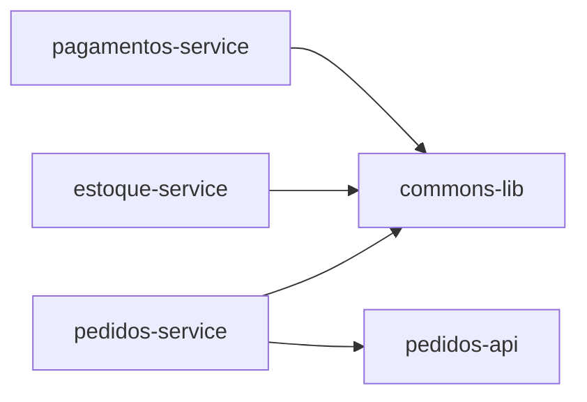
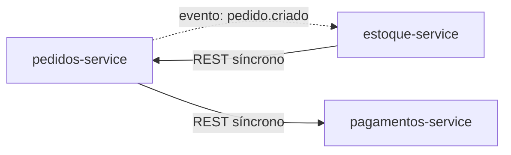

# Relatório de Acoplamento Arquitetural — loja-monorepo (exemplo fictício)
Data da análise: 2026-09-19

> ⚠️ Este é um exemplo ilustrativo, gerado a partir de um monorepo fictício, para mostrar o formato de
> saída esperado do prompt. Os módulos, métricas e trechos de código não correspondem a um projeto real.

## 1. Resumo Executivo
O monorepo `loja-monorepo` possui 14 módulos (dentro do teto de 25, sem necessidade de agregação por
domínio). A arquitetura de runtime é majoritariamente saudável, mas o módulo `commons-lib` concentra
acoplamento aferente alto com baixa abstração, caracterizando Zona de Dor. Foi detectado um ciclo de
dependência síncrona entre `pedidos-service` e `estoque-service`. Nenhum acoplamento por banco
compartilhado foi encontrado.

## 2. Metodologia
Análise estática via leitura de `pom.xml` (dependências de build), imports Java, anotações Spring
(`@FeignClient`, `@KafkaListener`), e arquivos `application.yml`. Granularidade: um nó por módulo
Maven. Grafo de runtime (REST + eventos) usado como fonte para o cálculo de Instabilidade no Main
Sequence.

## 3. Grafo de Dependências

### Grafo de Build/Import

### Grafo de Runtime (REST + Eventos)

## 4. Tabela de Métricas por Módulo

| Módulo | Fan-in build | Fan-out build | Fan-in runtime | Fan-out runtime | I | A | D | Zona | Em ciclo? |
|---|---|---|---|---|---|---|---|---|---|
| commons-lib | 6 | 0 | 0 | 0 | 0.00 | 0.10 | 0.90 | Zona de Dor | Não |
| pedidos-service | 1 | 3 | 1 | 2 | 0.67 | 0.35 | 0.02 | Saudável | Sim (runtime) |
| estoque-service | 1 | 2 | 1 | 1 | 0.50 | 0.40 | 0.10 | Saudável | Sim (runtime) |
| pagamentos-service | 1 | 2 | 1 | 0 | 0.00 | 0.55 | 0.45 | Zona de Inutilidade (leve) | Não |
| pedidos-api | 1 | 0 | 0 | 0 | 0.00 | 1.00 | 0.00 | Saudável | Não |

## 5. Main Sequence
- **commons-lib**: A=0.10, I=0.00 → D=0.90. Zona de Dor severa — módulo praticamente todo concreto,
  usado por 6 dos 14 módulos.
- **pagamentos-service**: A=0.55, I=0.00 → D=0.45. Leve tendência à Zona de Inutilidade — parte da
  interface exposta parece não ter consumidor de runtime mapeado.
- Demais módulos próximos da Main Sequence (D ≤ 0.30).

## 6. Ciclos de Dependência Detectados
- **Ciclo em runtime**: `pedidos-service → estoque-service → pedidos-service`
  - `pedidos-service` publica evento `pedido.criado` consumido por `estoque-service`
    (evidência: `pedidos-service/.../PedidoEventPublisher.java:34`)
  - `estoque-service` chama `pedidos-service` via REST síncrono para validar dados do pedido
    (evidência: `estoque-service/.../PedidoClient.java:18`, `@FeignClient(name="pedidos-service")`)
  - Risco: mistura de acoplamento síncrono e assíncrono entre os mesmos dois serviços.

## 7. Top 5 Riscos Priorizados

1. **commons-lib — Zona de Dor (D=0.90)**
   Evidência: `pom.xml` de 6 módulos declara dependência direta em `commons-lib`.
   Recomendação: extrair interfaces para os utilitários mais usados; aplicar Inversão de Dependência
   antes de qualquer refatoração nele, dado o alto fan-in.

2. **Ciclo pedidos-service ↔ estoque-service**
   Evidência: `PedidoEventPublisher.java:34` e `PedidoClient.java:18`.
   Recomendação: eliminar a chamada síncrona reversa; se `estoque-service` precisa de dados do pedido,
   incluí-los no payload do evento em vez de fazer callback síncrono.

3. **pagamentos-service — tendência à Zona de Inutilidade**
   Evidência: interface `PagamentoGatewayPort` sem implementação consumida por outros módulos.
   Recomendação: validar se a abstração ainda é necessária ou se pode ser simplificada.

4. *(demais riscos omitidos neste exemplo)*
5. *(demais riscos omitidos neste exemplo)*

## 8. Recomendações Gerais
- Priorizar quebra do acoplamento de `commons-lib` no próximo ciclo de débito técnico.
- Padronizar: comunicação entre `pedidos-service` e `estoque-service` deveria ser 100% assíncrona.
- Revisar interfaces "órfãs" (candidatas à Zona de Inutilidade) antes de novos desenvolvimentos.

## 9. Limitações da Análise
- Não foram encontradas URLs montadas dinamicamente neste exemplo fictício; em projetos reais, esse
  padrão pode mascarar acoplamento adicional não capturado aqui.
- Critério de Abstração (A) é aproximado, baseado em contagem de interfaces vs. classes concretas por
  módulo — sujeito a ajuste manual conforme convenções do projeto.
- Repositório abaixo do teto de 25 nós — nenhuma agregação por domínio foi necessária.

## Anexos
- `acoplamento.json` — dados brutos completos, incluindo evidências de cada aresta
- `acoplamento.mmd` — arquivo fonte dos grafos (build e runtime)
